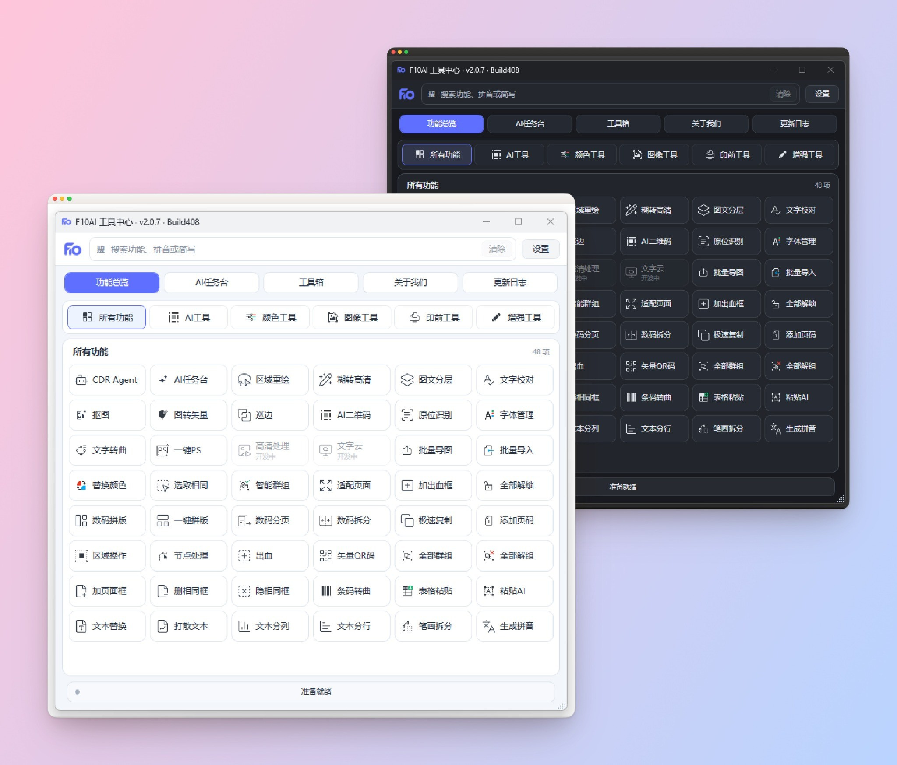
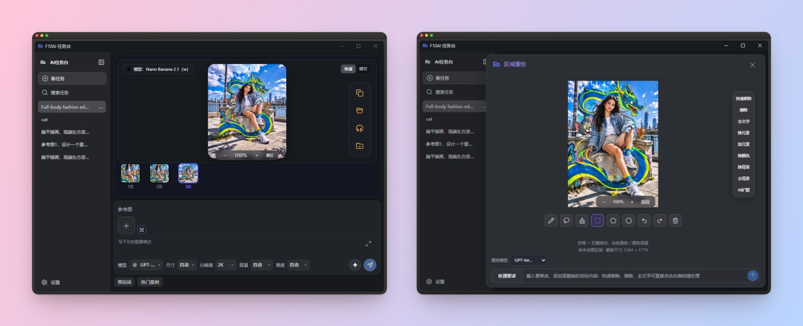
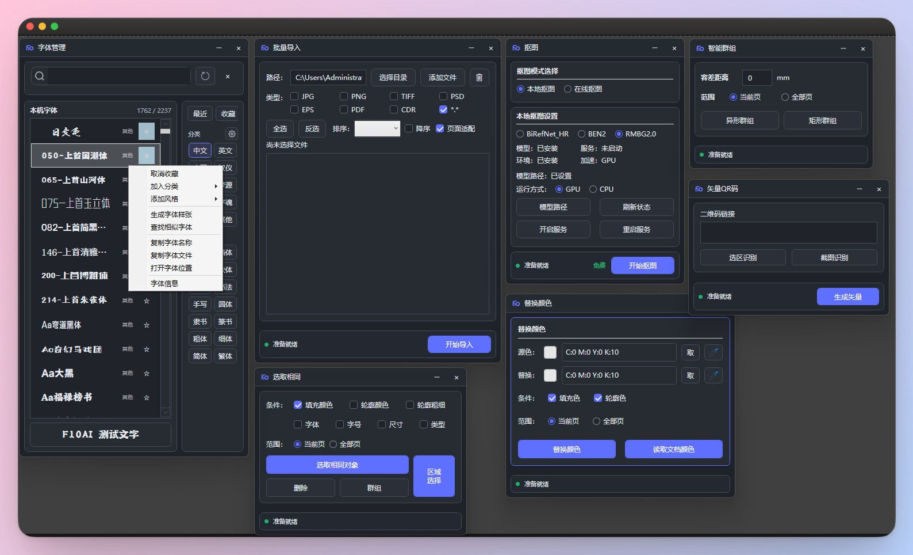
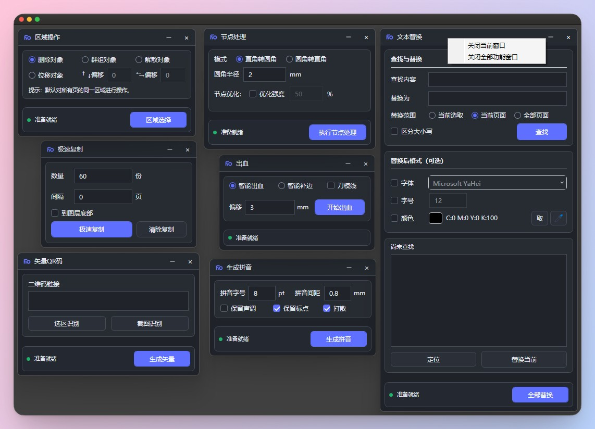
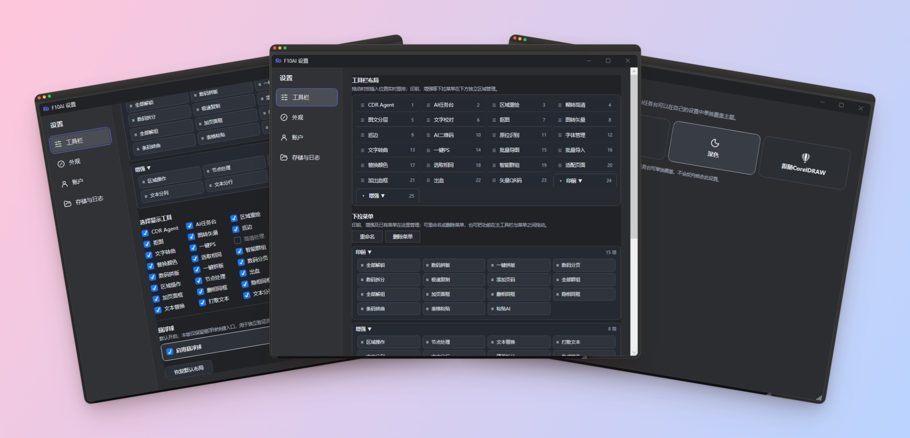
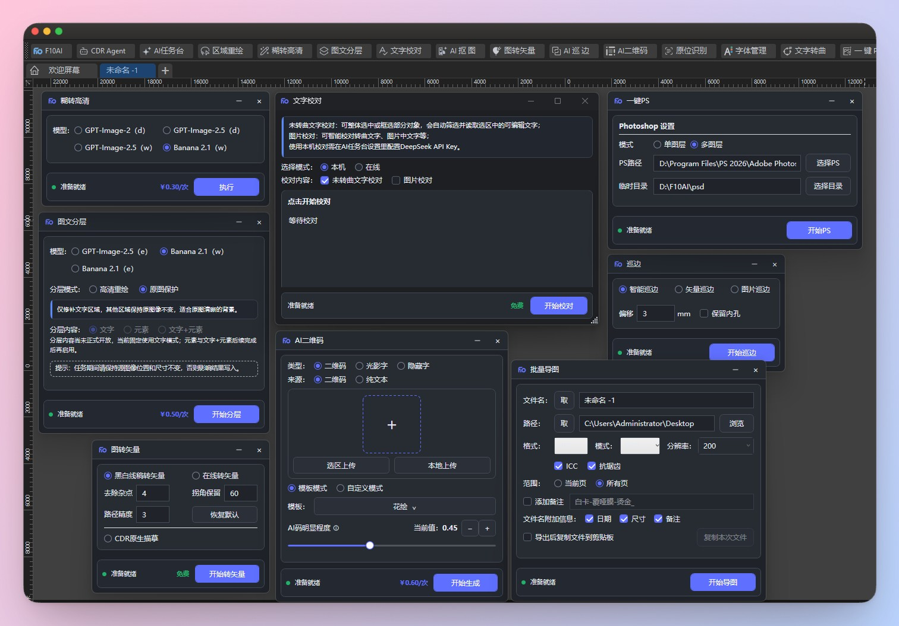
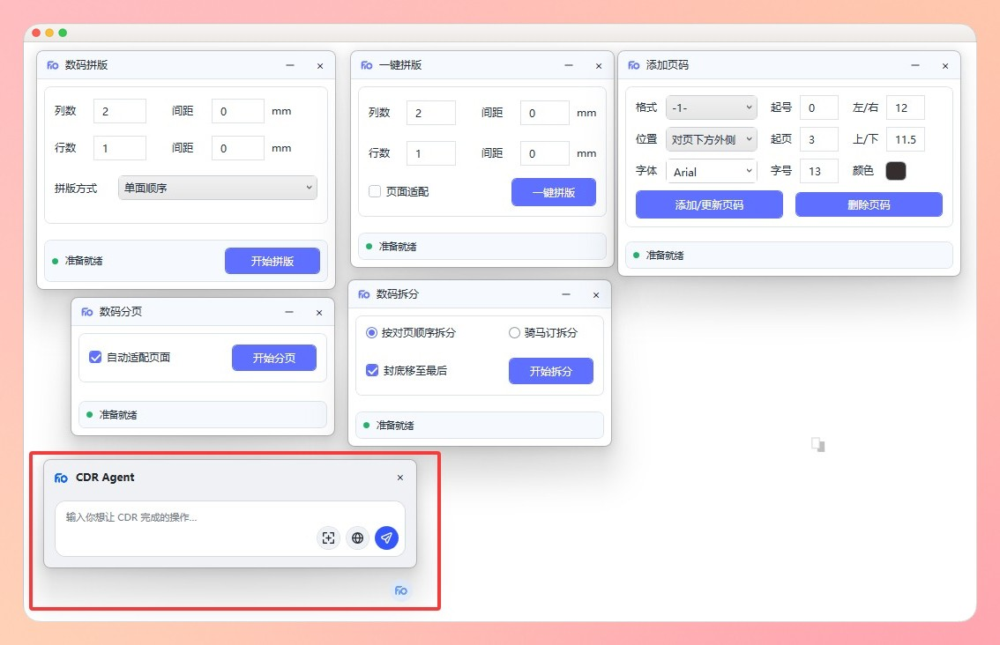

# F10AI

### CorelDRAW AI 智能设计辅助插件

**将 AI 创作、图像处理、字体管理及印前辅助工具集成到 CorelDRAW。**

  

[功能介绍](#主要功能) · [界面预览](#界面预览) · [安装教程](docs/installation.md) · [English](README_EN.md) · [问题反馈](../../issues)

> 本仓库为 F10AI **官方产品展示与文档仓库**，不包含插件源码、授权系统或服务端代码。下列截图可能来自较早的开发版本；功能可用性以正式发布版本为准。

## 界面预览

### 工具中心 — 浅色与深色主题

### AI 任务台与区域重绘

### 字体、图像和印前工具

## 主要功能

| 分类 | 功能 | 用途 |
| --- | --- | --- |
| AI 创作 | AI 任务台、区域重绘 | 图像生成、局部修改、移除和替换元素 |
| 图像处理 | 智能抠图、图转矢量、巡边、高清处理 | 图片编辑、矢量转换与清晰度增强 |
| 字体与文字 | 字体管理、原位识别、文字校对、文本替换、转曲还原 | 字体预览、文字识别、编辑和修复 |
| 排版印前 | 数码拼版、一键拼版、分页、拆分、页码 | 提高印刷排版工作效率 |
| 颜色与二维码 | 替换颜色、选取相同、AI 二维码、矢量二维码 | 颜色处理与图形生成 |
| 批量与辅助 | CDR Agent、批量导入、批量导图、智能群组、节点处理 | 减少重复的 CorelDRAW 操作 |

**更多界面展示**

> 说明：部分功能需要网络、第三方服务、本地 AI 模型或其他软件支持；处于开发或测试状态的功能不代表已经在正式版本开放。

## 运行环境

- **操作系统**：Windows
- **CorelDRAW**：X8–2026，具体版本支持情况请参考正式发布说明
- **AI 依赖**：部分在线功能需要网络；部分本地 AI 功能需要额外部署模型和运行环境

## 下载与安装

**官方下载地址待公布。** 正式安装包发布后将在此补充可信下载入口。请勿使用来源不明的安装包。

- [安装教程](docs/installation.md)
- [版本发布（Releases）](../../releases)
- [完整功能说明](docs/features.md)
- [更新日志](CHANGELOG.md)

## 问题反馈

欢迎通过 [GitHub Issues](../../issues) 反馈 BUG、兼容性问题和功能建议。请附操作步骤、CorelDRAW/F10AI 版本以及可公开的截图，勿上传 API Key、设备码等敏感信息。

## 授权与版权

F10AI 为**商业闭源软件**。本公开仓库仅用于产品介绍和使用文档，不构成对核心软件、源码或品牌素材的开源授权。详情请参阅 [版权声明](LICENSE.md)。

---

F10AI · 为 CorelDRAW 设计工作提效

